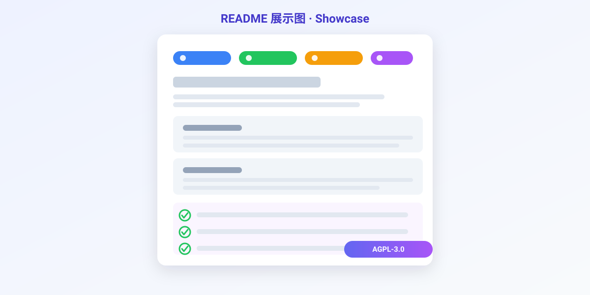
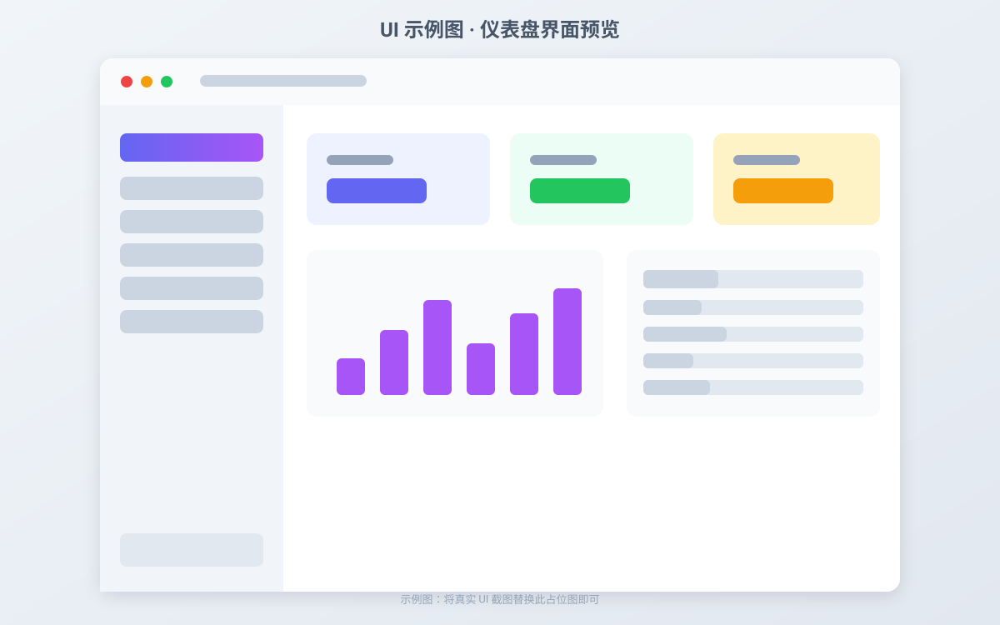

<div align="center">

[](LICENSE)
[](https://www.rust-lang.org)
[](https://github.com/awujiana/neve)
[](https://github.com/awujiana)
[](https://github.com/awujiana/neve)
[](https://github.com/awujiana/neve)

<h1>Névé 粒雪</h1>

<strong>PCL2 式 MPV 内核播放器管理器 —— 检测、安装、脚本、配置，一站式管理所有使用 MPV 内核的播放器</strong>

简体中文 | [English](./README_EN.md)（待补充）

> 本仓库当前为**私有仓库**，待完成可使用的版本后转为公开。

</div>

---

> [!WARNING]
> 本项目的相当一部分代码由 AI 辅助生成，并经过持续的人工作业、联调和重构，但它仍然可能存在遗漏、边界情况处理不足或行为与预期不完全一致的问题。如果你在使用过程中发现 Bug、兼容性问题、异常行为或文档缺失，欢迎积极提交 Issue。最好附上复现步骤、日志、截图和系统版本信息，这会非常有帮助。

## 📚 目录

- [项目简介](#-项目简介)
- [核心功能](#-核心功能)
- [展示图](#-展示图)
- [快速开始](#-快速开始)
- [文档](#-文档)
- [注意事项](#-注意事项)
- [反馈建议](#-反馈建议)
- [关联仓库](#-关联仓库)
- [作者联系方式](#-作者联系方式)
- [开源协议](#-开源协议)

## 🚀 项目简介

`Névé`（粒雪）是一个面向所有 **MPV 内核播放器**（mpv、mpv.net、Celluloid、IINA 及各类整合包）的统一管理器，由 **awujian** 维护。

它解决的核心问题是：MPV 系播放器配置与脚本管理全靠手动——多套整合包各自为政、脚本重复安装、文件关联与系统配置分散无入口。

它围绕以下目标设计：

- 一个界面管理所有 MPV 内核播放器：检测、安装、切换、更新
- 脚本与配置跨整合包一键同步，消灭重复劳动
- 交互体验对标 PCL2：清爽侧栏、动画流畅、开箱即用

简单来说：

> 把折腾 MPV 的所有体力活，交给粒雪。

项目基于：

- **Rust 2024 edition**（1.85+ 稳定工具链）
- **GPUI 0.2** —— Zed 的 GPU 加速原生渲染框架，无 WebView 依赖，单二进制
- **gpui-component 0.8** —— 60+ 桌面组件库（列表/侧栏/输入框，接入中）

## ✨ 核心功能

- **播放器管理**：自动检测本机所有 MPV 内核播放器（路径/注册表/PATH 三路扫描），支持 mpv-Bingshan 整合包与 shinchiro/zhongfly 构建源的安装与更新。
- **脚本管理**：lua 脚本（uosc 系）一键安装、启停、更新与依赖扫描；**一键应用到其他整合包、一键同步脚本配置到其他整合包**，同步前自动备份、可恢复。
- **uosc 深度支持**：uosc 及配套脚本的专项安装/更新（Git 源），`uosc.conf` 元素显隐、主题色、缩放等可视化调整，推荐按键自动合并。
- **皮肤 UI 管理**：uosc 主题、ModernX 等 OSC 皮肤一键换装，多皮肤共存随时切回，旧 OSC 自动软禁用（不删文件），皮肤预览一览。
- **一键配置**：视频文件关联注册、input.conf 按键配置（可视化 + 冲突检测）、mpv.conf 分类编辑、各脚本 conf 统一入口，所有修改可回滚。
- **外观定制**：深浅色主题、背景图片、透明度、列表大小与动画均可调整，**支持跟随系统外观**。
- **数据管理**：数据导出/导入；**便携版数据随目录移动，安装版可自定义数据位置**。
- **系统集成**：开机自启、托盘运行、中英文界面、操作音效、新版本检查。
- **收藏与置顶**：保存长期使用的内容，最常用的放在前面，拖拽即可调整顺序。
- **备注与编辑**：为内容写容易辨认的说明；常用文本可新增、修改，**已捕获的原始内容仍可恢复**。

## 📷 展示图

### 项目展示图



### UI 示例图（界面预览）



> 当前为占位图，真实截图将在首个可用版本发布时替换（建议 16:9 / 16:10，宽度 ≥ 1200px）。

## 📦 快速开始

<details>
<summary><strong>方式一：从 Releases 下载（规划中）</strong></summary>

前往 [Releases](https://github.com/awujiana/neve/releases) 下载对应平台的产物并解压。当前项目处于骨架开发阶段，尚未发布正式版本。

</details>

<details open>
<summary><strong>方式二：从源码构建</strong></summary>

```powershell
# 1. 安装 Rust（如未安装）：https://rustup.rs ，需 1.85+ 稳定版
rustup default stable

# 2. 构建并运行
cargo run --release

# 运行测试
cargo test
```

> 首次构建需编译 GPUI 及其图形后端依赖，耗时较长；之后增量编译很快。

</details>

## 📖 文档

- [设计文档（PRD）](docs/设计文档.md) —— 需求、用户故事、验收标准、里程碑
- [架构文档](docs/架构文档.md) —— 分层架构、模块划分、数据存储、关键流程、风险
- [UI 设计规范](docs/UI设计规范.md) —— 页面结构、液态玻璃视觉语言、昼夜主题切换与交互原则
- [主题令牌配置](config/ui-theme.toml) —— 主题色、玻璃表面、动效与无障碍基线（设计参考，尚未接入运行时）

## ⚠️ 注意事项

- 项目处于**骨架开发阶段**，功能尚未完整实现，接口与数据格式可能变动
- 文件关联、开机自启涉及注册表写入：实现后将**只写 HKCU 并在写前自动备份**，但仍建议使用前了解相关风险
- 跨包同步功能对目标整合包的写操作将强制走备份机制，冲突默认提示而非静默覆盖
- 首次编译 GPUI 依赖耗时较长属正常现象

## 💬 反馈建议

提交 Issue 时建议附上：

- 系统 / 运行环境版本（Windows 版本、GPU）
- 复现步骤
- 相关日志
- 截图或录屏

## 🔗 关联仓库

- [awujiana/neve](https://github.com/awujiana/neve) — 本仓库（当前私有，待可用版本后公开）
- [mpv-Bingshan](../mpv-Bingshan) — MPV 整合包制作仓库，粒雪负责其包的安装与管理

## 📮 作者联系方式

- **作者**：awujian
- **GitHub**：[@awujiana](https://github.com/awujiana)
- **邮箱**：待补充（暂请通过 GitHub Issue 联系）

## 📄 开源协议

本项目基于 **[AGPL-3.0](LICENSE)**（GNU Affero General Public License v3.0）开源。

根据 AGPL-3.0 的要求：任何人使用、修改或分发本项目代码，若以网络服务器形式向用户提供交互服务，必须同样以 AGPL-3.0 公开其完整对应源代码。

版权所有 © awujian。
